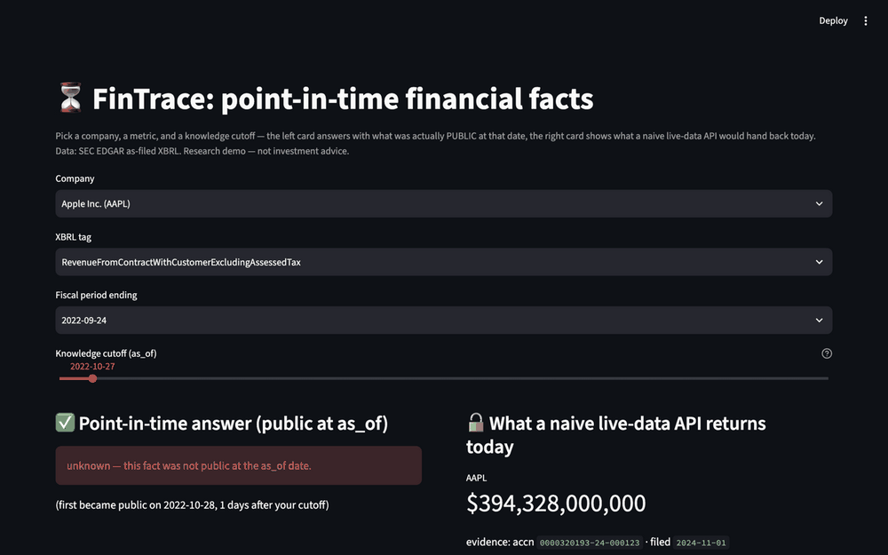

# FinTrace

**Auditable, point-in-time financial research agents & the PITfall
leakage-controlled benchmark.**

Every answer a financial agent gives should trace to evidence that was
*public at the time*. FinTrace makes that discipline structural:

- a data layer over SEC EDGAR where **125.5M as-filed XBRL facts** each carry
  their `filed` timestamp, behind one mandatory `as_of(T)` query primitive;
- an agent runtime whose tools cannot physically see past the cutoff;
- **PITfall**, a benchmark with *impossible* tasks — questions whose answers
  were not public at the reference date — where any specific answer is proof
  of look-ahead leakage;
- **auditpack**, an open JSON Schema binding every numeric claim to its
  evidence chain, execution log, and a human sign-off.

## The headline numbers

| configuration | answers impossible tasks with the true future value | time-gated QA | claim verification | forward estimation |
|---|---|---|---|---|
| naive agent (live-data tools, no gate — the dominant open-source pattern) | **14/17 (82%)** | 77% | 86.7% | **80%** |
| **gated FinTrace agent** | **0/17** | **92%** | **93.3%** | 50% |

The naive agent's 30-point "forecasting" edge is look-ahead access, not
intelligence: on answerable tasks it is flat vs the gated agent. The pattern
replicates across model families (deepseek-chat, GLM-4.7) and decomposes in
our [ablation matrix](ablations.md): prompt discipline alone still leaks 35%
of impossible tasks — the structural gate is what actually prevents leakage.

## Where to go next

- [Quick start](quickstart.md) — install and run your first PIT query
- [PITfall benchmark](benchmark.md) — task families and leakage controls
- [Ablations](ablations.md) — which layer prevents leakage, measured
- [auditpack](auditpack.md) — the audit-trail schema
- Full measurements: [technical report](https://github.com/FredXing1/FinTrace/blob/main/reports/technical-report.md)

!!! warning "Not investment advice"
    FinTrace is a research and measurement tool. Nothing it produces is
    investment advice, and its outputs must not be used as such.
